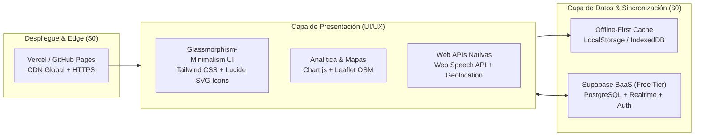

# Notas Quickss — Hub Operativo & Analítica de Equipo (MVP)

**Notas Quickss** es una aplicación web *mobile-first* y *desktop-responsive* diseñada bajo una estética **Glassmorphism-Minimalism (Dark Violet)** para centralizar la operación diaria del equipo en segundos, con **costo de infraestructura $0**.

---

## 1. Flujo Principal de Usuario (Experiencia al Iniciar Sesión)

Cuando un integrante del equipo entra a **Notas Quickss** o selecciona su usuario en la barra superior / Drawer lateral:

1. **Primer Panel — Analítica Personal de Actividades Planteadas**:
   - Antes de entrar a cualquier formulario, la persona visualiza una radiografía en vivo de **cómo va hoy en todas sus actividades planteadas**:
     - **Anillo Global de Cumplimiento (`0% – 100%`)**: Ponderación automática de su jornada.
     - **Meta de Brigada (`12 acercamientos`)**: Progreso actual, clientes muy interesados captados y estado de su kit.
     - **Daily Chat del Día (`Ayer · Hoy · Bloqueante`)**: Estado de publicación de su sincronización diaria y su foco activo.
     - **Tareas Planteadas**: Ratio de pendientes completados vs. urgentes de prioridad alta.
     - **Bitácora & Acuerdos**: Estado disciplinario y compromisos activos.
     - **Curva de Cumplimiento (`Chart.js`) + Hoja de Ruta Accionable**: Lista inteligente con accesos de 1 toque a lo que le falta completar hoy, más un switch para alternar entre **`Mis Actividades`** y **`Todo el Equipo`**.
2. **Segundo Panel — Selector de Módulos Operativos**:
   - Debajo de sus analíticas personales, el usuario elige el módulo específico en el que desea trabajar (`Brigadas Comerciales`, `Daily Chat`, `Tareas Pendientes` o `Llamados de Atención`), o navega en cualquier momento desde el **Floating Glass Navbar** inferior o el **Burger Drawer** superior.

---

## 2. Los 2 Pilares Core del MVP

### Pilar A: Daily Chat / Daily Day Estructurado
Diseñado para eliminar reuniones largas y estandarizar el reporte diario de cada miembro del equipo bajo una estructura clara de **3 puntos**:

```text
✅ Ayer: [Qué lograste, cerraste o avanzaste en la jornada anterior]
🎯 Hoy: [Cuál es tu foco principal y compromiso medible para hoy]
🚧 Bloqueante: [Qué te detiene o qué apoyo necesitas del equipo / Ninguno]
```

- **Características clave**:
  - Formulario guiado en el orden exacto **Ayer → Hoy → Bloqueante** más indicador de energía/ritmo (`A tope`, `Enfocado`, `Con bloqueos`).
  - **Botón "Copiar Chat" en 1 toque**: Genera y copia al portapapeles el bloque formateado con `✅ Ayer:`, `🎯 Hoy:` y `🚧 Bloqueante:` listo para pegar en WhatsApp, Slack, Discord o Teams.
  - **Muro del Equipo en Vivo**: Visualización de todos los reportes diarios resaltando automáticamente en color ámbar a los integrantes que reportaron algún **Bloqueante** para que el líder pueda destrabarlos rápido.

### Pilar B: Brigadas Comerciales en Terreno (< 10 segundos por negocio)
Diseñado para capturar información real en la calle sin frenar el ritmo comercial hacia la **meta de 12 acercamientos diarios por persona**:

1. **Check-in Previo de Equipamiento (1 vez al iniciar ruta)**:
   - Verificación con switches Tailwind de: **¿Tienes el carnet puesto?**, **¿Tienes tarjetas?**, **¿Tienes folletos?**, **Zona/Sector** y **Meta diaria (12 visitas)**.
2. **Captura Ultra-Ágil del Acercamiento**:
   - **Negocio y Dirección con GPS**: Autocompletado de calle/carrera en 1 toque mediante geolocalización del navegador + geocodificación inversa gratuita (**OpenStreetMap Nominatim**).
   - **Radar Anti-Duplicados en Tiempo Real**: Avisa al instante si ese local o dirección ya fue visitado previamente y qué respondió.
   - **3 Estados de Respuesta con Condiciones Específicas**:
     - **Muy Interesado (`+50 XP`)**: Captura qué condición específica pidió el cliente para comprar (con **Dictado por Voz** vía *Web Speech API* y botón directo de seguimiento por **WhatsApp**).
     - **Solo Info / Ya tiene sistema (`+20 XP`)**: Registra el negocio y su dirección dejando trazabilidad de que se entregó información o qué sistema utiliza actualmente.
     - **No Interesado (`+10 XP`)**: Registra el motivo de descarte rápido para analítica de objeciones.
3. **Mapa de Cobertura, Podio XP y Analítica Comercial**:
   - Mapa interactivo (**Leaflet**) con pines por color según estado, tabla de oportunidades calientes y exportación directa a **Excel (`.CSV` UTF-8)**.

### Módulos Complementarios Activos
- **Tareas Pendientes (`To-Do Operativo`)**: Asignación por responsable, selector segmentado de prioridad (`Alta`, `Media`, `Baja`) y verificación en 1 clic.
- **Llamados de Atención & Bitácora**: Registro estructurado de observaciones preventivas, llamados verbales o formales (ej. salir sin carnet, puntualidad) junto con el **compromiso acordado**.

---

## 3. Planificación del Stack Tecnológico (Actual vs. Escalabilidad Recomendada)

Para abarcar tanto la **velocidad inmediata del MVP** como el **crecimiento futuro multi-equipo sin costos fijos ($0/mes)**, se plantea una arquitectura en **2 fases**:



### 3.1. Stack Tecnológico Actual (MVP Ligero & Zero-Build)
Ideal para iteración rápida, carga instantánea en móviles con datos móviles limitados y despliegue directo sin pasos de compilación complejos:

| Capa | Tecnología Elegida | Justificación Técnica | Costo |
| :--- | :--- | :--- | :--- |
| **UI & Estilos** | **HTML5 Semántico + Tailwind CSS + CSS Variables** | Diseño **Glassmorphism-Minimalism**, controles 100% personalizados (sin `<select>` ni `prompt()` nativos), accesible (`WCAG AA`). | **$0** |
| **Iconografía** | **Lucide Icons (SVG)** | Iconos vectoriales nítidos y consistentes (cero dependencia de emojis del sistema operativo). | **$0** |
| **Lógica & Estado** | **Vanilla JavaScript (ES6+) + LocalStorage Cache** | Persistencia inmediata *Offline-First* (nunca se pierde una nota en calle aunque falle la señal celular). | **$0** |
| **Visualización & Geo** | **Chart.js 4 + Leaflet.js + Nominatim OSM** | Gráficas de cumplimiento personal/grupal y geocodificación inversa de direcciones sin requerir tarjeta de crédito de Google Maps. | **$0** |
| **Voz & Mensajería** | **Web Speech API + WhatsApp Deep Links (`wa.me`)** | Dictado por voz nativo en navegador móvil y apertura de chat con mensaje pre-armado según las condiciones del cliente. | **$0** |
| **Backend & Nube** | **Supabase (`@supabase/supabase-js` v2)** | Base de datos PostgreSQL en la nube con sincronización en tiempo real entre todos los teléfonos del equipo. | **$0** |

### 3.2. Stack Recomendado para Escalabilidad (Fase 2 — Producción Multi-Sede)
Cuando el proyecto crezca a múltiples equipos, autenticación individual con roles estrictos, notificaciones *push* y nuevos módulos (`Minutas por Voz`, `Cierres & Ventas`, `Stock Publicitario`), esta es la arquitectura objetivo recomendada:

| Capa | Stack Recomendado (Fase 2) | Qué resuelve al escalar |
| :--- | :--- | :--- |
| **Framework Frontend** | **Next.js (App Router) + TypeScript** (o **Astro + React**) | Rutas protegidas por rol (`Admin` vs `Brigadista`), renderizado híbrido ultrarrápido y tipado estricto para todos los módulos. |
| **Sistema de Componentes** | **Tailwind CSS + shadcn/ui (Radix Primitives)** | Drawers, Dropdowns, Command Palettes y Modales con accesibilidad total de teclado/lector de pantalla y estética Glassmorphism. |
| **Estado & Offline Sync** | **TanStack Query + Dexie.js (IndexedDB) + PWA Service Worker** | Cola de sincronización en segundo plano (*Background Sync*): si un brigadista anota 12 visitas sin internet, se suben solas al recuperar señal. |
| **Base de Datos & Auth** | **Supabase (PostgreSQL + Supabase Auth + RLS)** | Inicio de sesión real con correo/PIN o Google, políticas de seguridad por fila (*Row Level Security*) y *Webhooks* en tiempo real. |
| **Automatización Chat** | **Supabase Edge Functions + WhatsApp / Slack Webhook** | Al publicar el **Daily Chat (`✅ Ayer / 🎯 Hoy / 🚧 Bloqueante`)** en la web, puede enviarse automáticamente al grupo del equipo. |
| **Pruebas & Calidad** | **Playwright CLI** | Pruebas automatizadas *end-to-end* en resoluciones móviles (`375px`) y escritorio (`1440px`). |
| **Hosting & CI/CD** | **Vercel (Hobby Free Tier) + GitHub Actions** | Despliegue continuo en cada `git push` a la rama `main` con URLs de previsualización. |

---

## 4. Estructura de Archivos del Proyecto

```text
Quickss_notes/
├── index.html                           # Hub de Analítica Personal, Drawer, Bottom Navbar y los 4 Módulos
├── styles.css                           # Tokens Glassmorphism-Minimalism, animaciones y reglas accesibles
├── app.js                               # Lógica de analíticas personales, Daily Chat, Brigadas, Tareas y Llamados
├── supabase_schema.sql                  # Script SQL para crear las tablas en Supabase PostgreSQL
├── design-system/
│   └── notas-quickss/
│       └── MASTER.md                    # Especificación oficial del sistema de diseño (UI/UX Pro Max)
└── README.md                            # Documentación del MVP y Arquitectura Tecnológica
```

---

## 5. Ejecución Local y Conexión a Supabase

### Ejecutar en entorno local
```bash
# Desde la carpeta del proyecto (usando puerto 4567)
npx -y http-server -p 4567 -c-1 -o
```
Luego abre `http://localhost:4567` en tu navegador o teléfono móvil.

### Activar Sincronización en Tiempo Real con Supabase ($0)
1. Crea un proyecto gratuito en [Supabase](https://supabase.com).
2. Ve al **SQL Editor** y ejecuta el contenido de [`supabase_schema.sql`](./supabase_schema.sql).
3. En **Notas Quickss**, abre el botón **Local / Nube** en la barra superior (o desde el **Burger Drawer**) y pega tu `Project URL` y tu `anon public key`.
